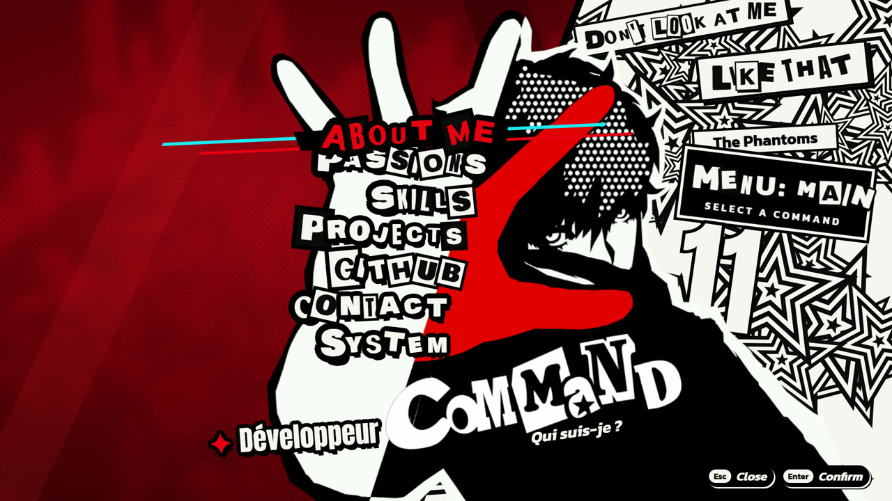
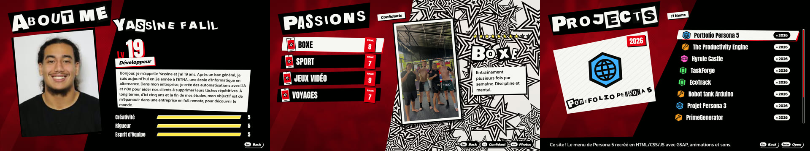

# Portfolio — Persona 5

Mon portfolio, dans le style du menu de **Persona 5** : animations, transitions et sons du jeu.

## L'essayer

Télécharge le projet, puis ouvre **`index.html`** dans ton navigateur. Rien à installer.
Pour le meilleur rendu : plein écran (**F11**) et le son activé.

| Touche | Action |
|---|---|
| ↑ ↓ | Se déplacer |
| ← → | Changer de photo · régler le volume |
| Entrée | Valider |
| Échap ou clic droit | Revenir |

## Le contenu

- **About Me** : qui je suis
- **Passions** : boxe, sport, jeux vidéo, voyages
- **Skills** : mes compétences
- **Projects** : mes projets
- **Contact** : me joindre

## Fait avec

HTML · CSS · JavaScript · [GSAP](https://gsap.com)

## Crédits

Projet fan, non commercial. Persona 5, ses visuels et ses sons © **ATLUS / SEGA**.
Polices : Google Fonts (licence OFL).
